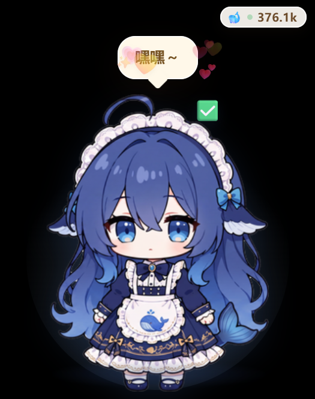
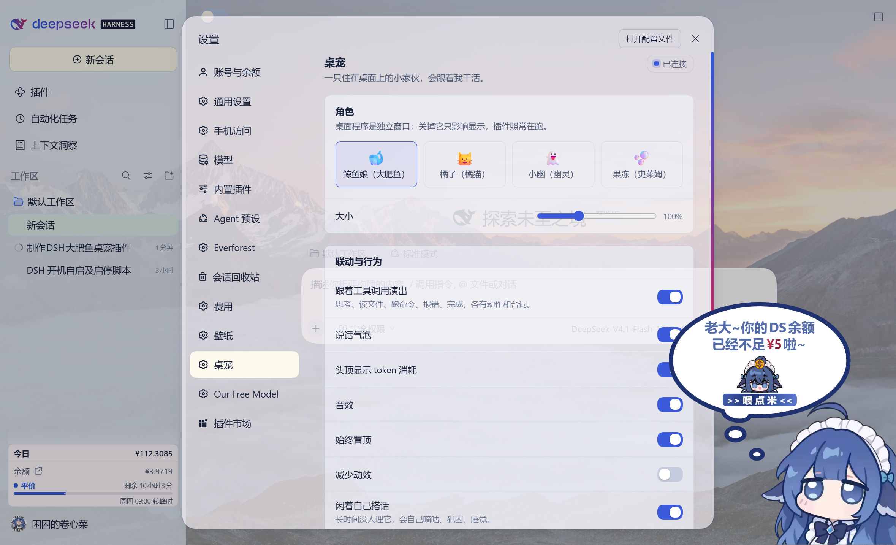

# DSH 桌宠 · 鲸鱼娘（大肥鱼）

把一只**真正盖在桌面上的**鲸鱼娘接到 [DeepSeek Harness](https://github.com/deepseek-ai) 上：独立透明置顶窗口、跟着 Agent 的工具调用演戏、头顶显示这一轮烧了多少 token。

> 不是网页里的小挂件 —— 桌宠是一个独立的 Electron 窗口，可以盖在任何程序上面；DSH 插件负责"翻译"和"遥控"。





## 它做了什么

| 能力 | 说明 |
| --- | --- |
| 跟着工具调用演出 | 思考 / 读文件 / 写文件 / 跑命令 / 上网 / 分派子智能体 / 等你回话 / 报错 / 完成，各换姿势和台词 |
| token 角标 | 头顶右下角显示本会话累计 token，Agent 在跑时小绿点呼吸；可在设置里关掉 |
| 真桌面交互 | 左键拖起来（有浮空影子和倾斜）、单击摸摸、双击打开 DSH、拖入文件投喂；所有菜单入口统一走托盘 |
| 状态播报 | 每轮结束播报 token/花费（💰）、等你回答（❓常驻）、余额不足喊"饿饿…喂喂…"（🍚） |
| **自己会动** | 照原版大肥鱼的行为模型：自由散步（左右侧面 / 上下正背面）、跟着鼠标跑、原地待着；走路会蹦、休息时摇摆/伸懒腰、偶尔自言自语（含灰色斜体心声） |
| DSH 开成独立应用窗口 | 双击宠物 / 托盘 / 桌面「DSH」图标 / 「DSH 重启」之后，界面以**独立应用窗口**打开（带任务栏图标、记住位置大小），不再是浏览器新标签；再点一次只聚焦 |
| 托盘常驻 | 换角色 / 静音 / 鼠标穿透 / 置顶 / 回到默认位置 / 打开肚子文件夹 / 退出 |
| 记性 | 位置、大小、角色存在本地，跨会话跨重启都记得 |
| 自己找事 | 没人理它会嘀咕、犯困睡着；饿了会提醒（拖文件投喂就吃饱） |
| 设置页 | DSH 里 **设置 → 桌宠** 一页搞定角色、大小、联动开关、音效、穿透 |

## 架构

```
┌──────────────────────── DSH（dsh web 进程）────────────────────────┐
│  plugin/index.js  (Host 半)                                         │
│    · 监听 session/event：tool/call、tool/result、turn/end、usage     │
│    · 把事件翻译成 { action, text, tone }                             │
│    · 在 127.0.0.1:39918 起一个小服务（HTTP + SSE，一次性 token）      │
│    · 写发现文件 %APPDATA%\dsh-desktop-pet\bridge.json               │
│    · 需要时拉起桌面程序（并看门狗式重拉）                             │
│  plugin/client.js (Client 半)                                       │
│    · 设置 → 桌宠：读 /api/state、写 /api/settings、遥控 /api/pet/*    │
└───────────────────────────────┬────────────────────────────────────┘
                                │ SSE（演出）/ HTTP（回报、设置）
┌───────────────────────────────┴────────────────────────────────────┐
│  pet/  (Electron 桌面窗口)                                          │
│    · 透明置顶无边框窗口，按形状穿透鼠标（只有宠物身上接点击）          │
│    · 鲸鱼娘三视图精灵 + CSS 动效（呼吸/蹦跳/摇晃/进食…）               │
│    · 托盘、投喂、位置记忆、音效                                       │
└────────────────────────────────────────────────────────────────────┘
```

**为什么拆两个进程**：DSH 插件的 Host 半跑在 `dsh web` 进程里，没法创建系统级窗口；想要真桌宠就必须有一个独立进程。插件退化成"大脑"，桌面程序是"身体"。

## 快速开始

环境：Windows 10/11、Node.js 20+、已装好的 DSH（`@deepseek-ai/dsh` ≥ 0.2.1-rc.2）。

### 1. 构建桌宠

```powershell
cd pet
npm install          # 网络慢可以加上面 README 里的镜像变量
npm run build        # 产出 out/，插件会直接用它跑
```

想做成免安装 exe（可选）：

```powershell
npm run dist         # 产出 pet/dist/DSH Desktop Pet-0.1.0-portable.exe
```

### 2. 装插件

三种方式，任选：

```powershell
# A. 用 DSH 自己的命令行
dsh plugin --profile web add link:<本仓库>/plugin

# B. 在 DSH 的对话里让 AI 调 plugin_manager install_bundle，target 填 <本仓库>/plugin

# C. 手工写进 profile 的 cordis.patch.yml（见 plugin/cordis.patch.yml 的注释）
```

### 3. 重启 DSH，然后在「设置 → 桌宠」里调

插件的 Host 代码（`index.js` / `lib/*.js`）和设置页（`client.js`）都是**装好或重启后才加载**的：
改完这两个文件要重启 `dsh web`；只改 `pet/` 里的东西则重新 `npm run build` + 重启桌宠进程即可。

## 配置

`plugin/cordis.patch.yml` 里的 `config`（都可省略）：

| 键 | 默认 | 说明 |
| --- | --- | --- |
| `enabled` | `true` | 总开关 |
| `port` | `39918` | 桥接端口；被占用会自动向后顺延，`0` = 随机 |
| `spawnPet` | `true` | 插件是否托管桌面进程（关掉就自己启动 exe） |
| `petExecutable` | `''` | 打包好的 exe 绝对路径，优先级最高 |
| `petAppDir` | `''` | 桌宠源码目录（含 `node_modules/electron`），开发模式用 |
| `logLevel` | `'info'` | `silent` / `info` / `debug` |

其余运行时设置（角色、大小、联动开关、音效、穿透…）都在 **设置 → 桌宠** 里改，落盘到
`%APPDATA%\dsh-desktop-pet\settings.json`，插件和桌宠共用同一份。

## 工具 → 动作对照

动作由三层叠成，所以同一个三视图素材也能演出十来种明显不同的小动作：

- **视图**：正面 / 侧面 / 背面（侧面还会左右翻转）
- **动作动画**：呼吸、走路、蹦跳、摇晃、伸懒腰、害羞、张望、进食、睡觉…
- **头顶道具**：📖 ⌨️ ⚡ 🌐 💭 ❓ 📝 ✅ 💢 🍙 💤 🎈

| DSH 事件 / 工具 | 视图 | 动作 | 道具 / 台词 |
| --- | --- | --- | --- |
| `turn/start` | 正面 | 歪头思考 | 💭 让我想想… |
| `read` `glob` `grep` `recall` `lsp` | 侧面 | 干活 | 📖 翻文件看看… |
| `write` `edit` | 侧面（反向） | 干活 | ⌨️ 动手改代码… |
| `bash` `pwsh` `run_code` `terminal_*` | 侧面 | 走起来 | ⚡ 跑命令… |
| `web_search` `web_fetch` `read_page` `mcp_*` | 正面 | 干活 | 🌐 上网查一下… |
| `subagent` `workflow` `team_task_*` | 侧面（反向） | 走起来 + 星星 | ✨ 叫上小伙伴… |
| `todo_write` `create_goal` `update_goal` | 正面 | 歪头思考 | 📝 理一下计划… |
| `ask_user_question` / 审批 | 正面 | 停住等你 | ❓ 等你回话～ |
| `tool/result` 报错 | 正面 | 生气 + 头晕蒸汽 | 💢 这步没成… |
| `turn/end`（正常） | 正面 | 蹦跳 + 爱心 | ✅ 搞定！ |
| `turn/end`（error/aborted/max-tokens） | 正面 | 生气 | 💢 出岔子了… |
| 左键拖拽 | 背面 | 被拎起来 | 🎈 + 浮空影子 |
| 鼠标闲置一会儿 | 正/侧 | 自己蹦一下、张望、伸懒腰、害羞 | 偶尔嘀咕一句 |

映射表在 `plugin/lib/actions.js`（工具→语义动作）和 `pet/src/renderer/src/pet/App.tsx` 的
`ACTION_LOOK`（语义动作→视图/动画/道具），想加动作改这两处即可。

## 打开 DSH ＝ 一个独立应用窗口



打开 DSH 的入口（双击宠物、托盘菜单、桌面「DSH」图标、桌面「DSH 重启」之后）都走同一个窗口：

- 窗口由**桌宠进程自己创建**（`pet/src/main/gui-window.ts`）：有任务栏图标、可最大化、位置和大小记在
  `%APPDATA%\dsh-desktop-pet\gui-window.json`，下次原样打开；
- 再次触发**只 `focus()`**，不会越开越多；DSH 重启后 token 变了会自动用新地址重载；
- 页面里的 `target=_blank` / `window.open` 一律交给系统浏览器，不会在窗口里叠一层；
- 「退出桌宠」时如果这个窗口还开着，只把宠物收起来、不关窗口（避免误关你正在用的界面）。
- 每次打开前都会向 Host 现取一次 `gui.url`（**带 token**），所以不会出现「桌宠刚启动就开窗 → 看到
  `dsh web authentication required`」；DSH 重启换 token 后也会用新地址重载。

**给启动脚本/快捷方式的钩子**：Bridge 暴露了一个幂等指令，任何本地脚本都能据此自动打开界面：

```powershell
# bridge.json 里存着 { port, token }
$b = Get-Content "$env:APPDATA\dsh-desktop-pet\bridge.json" -Raw | ConvertFrom-Json
Invoke-RestMethod -Method POST -Uri "http://127.0.0.1:$($b.port)/api/pet/command?token=$($b.token)" `
  -Body (@{ kind = 'open-gui' } | ConvertTo-Json -Compress) -ContentType 'application/json'
```

它保证「已经在跑就只聚焦，不再开第二个窗口」。

想回到浏览器标签：设置 → 桌宠 → 关掉「DSH 开在独立窗口里」。

**桌宠没起来时**（没装/没构建/被关掉）会退回浏览器，并且**不会重复开标签**：脚本先找已经打开的 DSH 标签
——按窗口标题粗筛，再逐个标签切过去**读地址栏 URL**、必须命中 `127.0.0.1:<DSH 端口>` 才算数，误试的标签会切回原位。
实现在 `pet/resources/focus-gui.ps1`（Win32 + UI Automation）。

**开机自启仍然只起服务、不弹界面**：自启链是 `计划任务 → vbs → dsh-web-start.ps1 -Quiet`，它只负责把服务拉起来；
界面由你点桌面图标或「DSH 重启」时再打开（后者由 `D:\DSH_MASTER\tools\dsh\dsh-open-gui.ps1` 触发）。

## 自己会动：直接抄原版的行为模型

`pet/src/main/motion.ts` 是把原版（[1190fasheqi/dafeiyu-pet](https://github.com/1190fasheqi/dafeiyu-pet) 的 `桌宠.py`）
的行为**按原参数**搬过来的，不是另起一套手感：

| 参数 | 原版取值（本实现一致） |
| --- | --- |
| 逻辑帧 | `TICK = 20ms`（50fps） |
| 速度 | `SPEED = 380px/s`，每帧向目标逼近 `0.3`（加减速惯性，不是匀速瞬移） |
| 到达判定 | 距离 < `12px` 算到达，然后**原地休息 8~18s** 再出发 |
| 边界 | 可用工作区留 `40px` 边距（本实现按窗口**中心**取点，保证整只鱼都在屏幕内） |
| 朝向 | `|dx| > |dy| × 1.15` 才算水平 → 侧视图（按方向镜像）；否则上=背面、下=正面 |
| 走路小动作 | 每帧 `0.2%` 概率蹦一下（`jump_t=0.5`，每帧 `-0.06`） |
| 闲置小动作 | 每帧 `1%` 概率：`35%` 蹦 / `25%` 摇摆 / `20%` 伸懒腰 / `10%` 说话（说话冷却 `1500` 帧 = 30s） |
| 跟随模式 | 光标离窗口 `100px` 内就停，否则把窗口挪到光标左侧 `90px` 处 |
| 气泡 | 2.8s 自动消失；心声是灰底斜体并带括号 |
| 视觉 | 走路摆动 `±3.5°`、上下 `7px`（周期 ~0.7s）；呼吸 `1 + 2%·sin(2.5t)`；蹦跳 `abs(sin)·14px` |

三种行动模式在**托盘菜单 → 行动模式**或**设置 → 桌宠 → 行动模式**里切：自由散步 / 跟着鼠标跑 / 原地待着。
台词表（`LINES` / `INNER_LINES`）也来自原版社区梗，放在 `motion.ts` 顶部，想换成 DSH 语境的自己改。

> 工具调用演出优先：一旦有工具动作/被拖拽，运动引擎立刻停手（`busyUntil`），演完再继续散步。

## 数据目录

```
%APPDATA%\dsh-desktop-pet\
├─ bridge.json       # 插件写的 { port, token }，桌宠照它连
├─ settings.json     # 设置（插件拥有，桌宠只读）
├─ window.json       # 窗口位置（桌宠拥有）
└─ belly\            # 投喂进来的文件
```

`bridge.json` 里有 token，**不要外传**；服务只绑 `127.0.0.1`，并且每次 DSH 启动换新 token。

## 换成别的角色

1. 把透明底的三视图 PNG 放进 `pet/src/renderer/public/sprites/`（建议高 340px）；
2. `pet/src/renderer/src/pet/characters/WhaleGirl.tsx` 里改 `SOURCES`，或照它写一个新组件；
3. `CharacterView.tsx` 里挂上新 id，`pet/src/shared/types.ts` 的 `CharacterId`、`plugin/lib/store.js`
   的 `CHARACTERS`、`plugin/client.js` 的 `CHARACTERS` 三处同步加 id；
4. 重新 `npm run build`，重启桌宠（角色列表的变化还要重启 DSH）。

内置还留了三只纯 SVG 画的备用角色（橘子 / 小幽 / 果冻），默认不再是它们。

## 素材与协议

- 本项目代码：**MIT**（见 [LICENSE](LICENSE)）。
- 鲸鱼娘（大肥鱼）三视图素材来自 [1190fasheqi/dafeiyu-pet](https://github.com/1190fasheqi/dafeiyu-pet)（MIT），
  原图是从白底三视图抠出来并做了边缘去污的精灵。详见 [NOTICE.md](NOTICE.md)。
- 「鲸鱼娘 / 大肥鱼」是 DeepSeek 形象的**社区二次创作**，形象版权归原作者与社区，本项目只做个人桌面玩具用途，
  **请勿商用**；二次分发请保留署名与来源。

## 已知限制

- 只测了 Windows 11；macOS / Linux 理论上能跑（窗口透明与托盘代码是跨平台的），但没有实测。
- 素材是三视图，不是逐帧动画包：睡觉/生气这些状态靠"换视图 + CSS 动效"表达，眼神细节不会变。
- 鼠标穿透打开后，只能从托盘菜单关回来（这是刻意的，穿透后窗口本身收不到点击）。
- 桥接端口是固定的本机端口，多开多个 DSH 实例时第二个会向后顺延端口。

## 开发

```
dsh-desktop-pet/
├─ plugin/                 DSH 插件包（Host 半 + Client 半 + 语言包 + 图标）
│  ├─ index.js             Host：桥接、事件翻译、进程托管
│  ├─ client.js            Client：设置 → 桌宠 页
│  └─ lib/                 bridge / store / watcher / actions / pet-process
├─ pet/                    Electron 桌宠
│  ├─ src/main/            窗口、托盘、拖拽、投喂、桥接客户端
│  ├─ src/preload/         暴露给渲染进程的 petAPI
│  ├─ src/renderer/        React 界面 + 三视图角色 + CSS 动效
│  └─ src/shared/          两侧共享的类型
├─ scripts/
│  ├─ capture-window.ps1   按窗口句柄截图（无需置顶；已处理 DPI 缩放）
│  └─ inspect-dom.mjs      通过 CDP 在桌宠窗口里跑表达式（调试用）
└─ docs/shots/             截图
```

常用命令：

```powershell
npm --prefix pet run dev          # 桌宠热更新开发
npm --prefix pet run build        # 构建
npm --prefix pet run typecheck    # 类型检查
node --check plugin/index.js      # 插件 Host 语法检查
```

调试桌宠画面：`electron.exe . --remote-debugging-port=9222`，然后
`node scripts/inspect-dom.mjs "JSON.stringify({w: innerWidth})"`。

## English

**dsh-desktop-pet** connects a real always-on-top desktop pet to the DeepSeek Harness.
A DSH plugin (Host + Client halves) translates `session/event`s — tool calls, errors, turn ends,
token usage — into pet actions over a token-guarded localhost HTTP+SSE bridge, and hosts a
Settings page under *Settings → Desktop Pet*. The pet itself is a separate Electron window
(`pet/`) with tray, drag, file-feeding, position memory and sound.

Install: build `pet/` (`npm install && npm run build`), add `plugin/` as a DSH bundle, restart DSH.
MIT licensed. The whale-girl artwork is a community fan work sourced from
[1190fasheqi/dafeiyu-pet](https://github.com/1190fasheqi/dafeiyu-pet) — personal use only, no commercial reuse.
